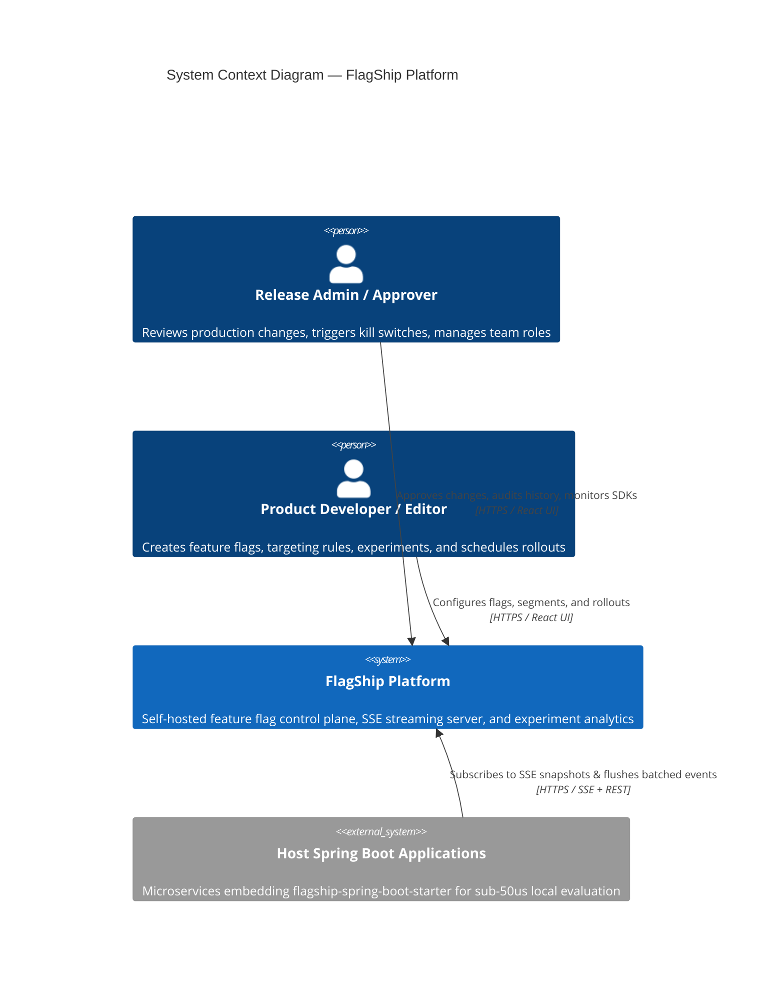
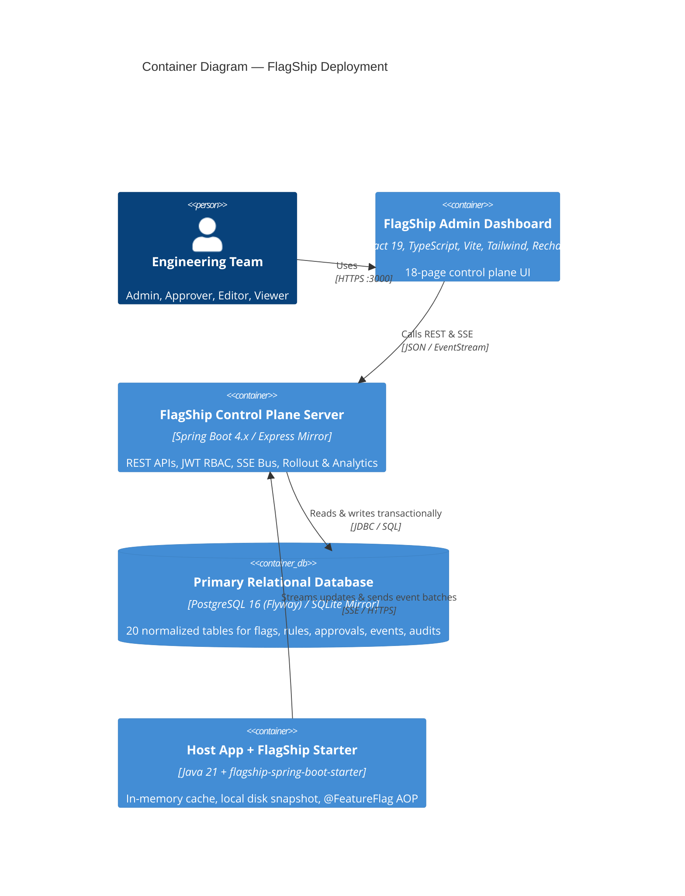
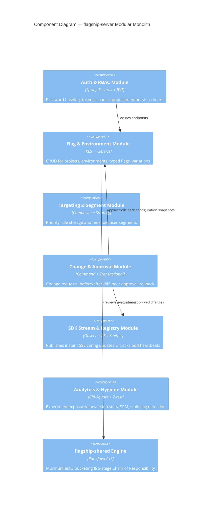

# FlagShip System Architecture (C4 & Modular Monolith)

## 1. Architectural Style
FlagShip uses a **Modular Monolith** architecture (`flagship-server`) paired with a zero-dependency shared evaluation kernel (`flagship-shared`), a reusable client library (`flagship-sdk`), and a React SPA Admin Dashboard.

---

## 2. C4 Level 1 — System Context Diagram

---

## 3. C4 Level 2 — Container Diagram

---

## 4. C4 Level 3 — Component Diagram (Backend Control Plane)

---

## 5. Module Dependency Boundaries (Enforced by ArchUnit)
1. `common` must never depend on feature modules (`auth`, `flag`, `approval`, `sdk`).
2. `auth` remains decoupled from `approval` and `sdk`.
3. `flagship-shared` contains zero Spring/web/JPA dependencies so both `flagship-server` and `flagship-sdk` execute identical evaluation logic.

---

## 6. Checkpoint Change Request (C10 Placeholder)
> **Reserved for Instructor Checkpoint Change Request**
> Status: Awaiting instructor specification during course checkpoint review. No speculative changes have been invented.
