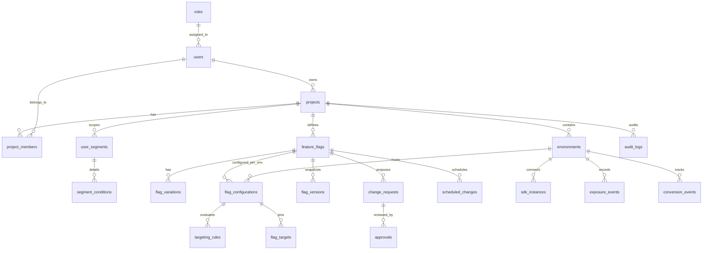

# FlagShip Database Design

FlagShip persists state across **20 normalized relational tables** managed via Flyway (`V1__init_flagship_schema.sql`) in PostgreSQL 16 (and mirrored identically in `server/db.ts` SQLite for the self-contained preview runtime).

## Entity-Relationship Diagram

## Key Integrity & Performance Decisions
1. **Unique Composite Keys**: `(project_id, key)` on `environments`, `feature_flags`, and `user_segments`; `(flag_id, environment_id)` on `flag_configurations`; `(flag_configuration_id, user_key)` on `flag_targets`.
2. **Optimistic Locking**: `opt_version` on `feature_flags`, `flag_configurations`, and `change_requests` prevents lost concurrent updates.
3. **High-Volume Event Indexes**: Composite B-tree indexes on `(flag_key, environment_id, occurred_at)` keep experiment aggregation queries fast as exposure and conversion logs grow.
4. **Transactional Approval Boundary**: Approving a `change_request` atomically updates `flag_configurations`, inserts a `flag_versions` snapshot, creates an `approvals` record, and writes an `audit_logs` entry.
